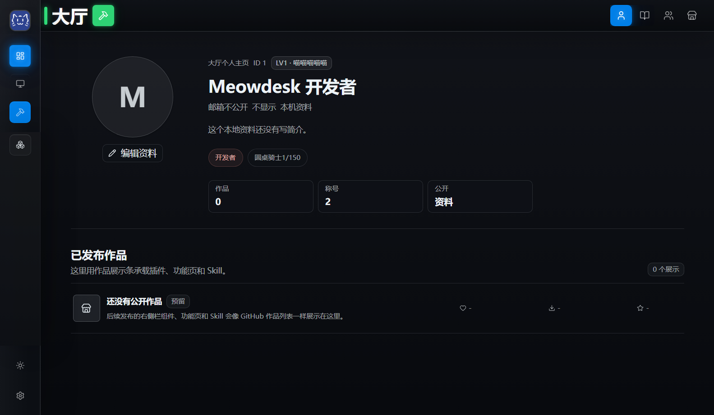
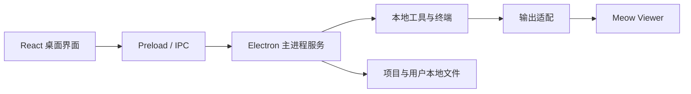

# Meowdesk

**把 AI 工具、项目和创作成果放进同一个桌面工作台。**

Meowdesk 面向希望用 AI 做东西的普通用户、Agent user 和 vibe coder。你可以在工作区使用本机工具与终端，在工坊整理自己的页面、小组件和作品，并把常用内容放在顺手的位置，让分散的 AI 协作过程有一个持续工作的地方。



*真实源码启动截图，使用隔离的空白用户数据；没有填入虚构用户、作品或使用量。*

## 可以做什么

- **工作区**：配置本机工具和终端，组织多个工作面板；通过现有 Agent 接入能力与本地 CLI 配合使用。
- **工坊**：管理本地创作项目、功能页和侧栏小组件，查看作品信息与版本，支持现有产品包导入/导出流程。
- **Meow Viewer**：把支持的 Agent 输出整理为更易阅读的消息和内容；终端与 Viewer 保持不同职责。
- **任务与资料**：提供任务中心、对话记录、本地资料/Obsidian 浏览等入口，串联工作上下文。
- **个人工作台**：深浅主题、可固定的工作入口、侧栏和桌宠等，服务于日常操作与个性化使用。

这些是当前代码中的开发能力，不代表所有第三方 Agent、插件或系统环境已兼容。使用外部 Agent 需要自行安装、登录和配置；本项目不提供模型账号或 API Key。

## 当前阶段

这是 `0.2.0` 开发阶段源码，基线为 **2026-07-10 / 9883004**，尚未作为正式安装版发布。2026-10-19 的公开整理只处理展示文档与隐私，不重新设计产品。

- Workflow Beta 已退出当前主线，不把历史设计中的能力当成当前功能。
- 旧 VS 视觉参考与 legacy renderer 不作为独立当前产品入口。
- Hermes 新版 SQLite 会话兼容修复曾在另一设备的未提交工作区进行，**不在本公开快照内**。Viewer 对实际 Agent 版本的兼容仍需验证。
- 未宣称已经完成商业化、规模化用户验证或全部运行场景验收。

## 运行

本轮在 Windows、Node.js 24.15、项目现有 Electron 33 依赖环境下验证。项目使用 Vite 8，安装依赖时请满足其 Node.js 要求。Windows 原生依赖 `node-pty` 的安装/编译取决于本机工具链。

```powershell
git clone https://github.com/shizukuocean/meowdesk.git
cd meowdesk
npm ci
npm run dev
```

`npm ci` 会下载依赖及 Electron。未配置外部 Agent 时仍可查看工作台；使用相关能力后，再在界面配置本机工具。用户数据由应用在本机生成，不从此仓库恢复。不要把真实对话、凭据或个人知识库提交到仓库。

```powershell
npm run typecheck:renderer
npm run build:renderer
npm run test:workbench-contract
```

验证范围和未覆盖项见 [验证记录](docs/VALIDATION.md)。源码公开不等于提供已签名安装程序。

## 技术与结构

Electron 主进程 + React / TypeScript 界面，使用 Vite 构建；本地终端由 node-pty / xterm 接入，页面组件使用 Radix UI，动画使用 GSAP。



| 目录 | 作用 |
|---|---|
| `src/main.js`、`src/main/` | 桌面入口、工具启动、终端与本地服务 |
| `src/preload.js` | 主进程与界面之间的受控桥接 |
| `src/renderer-app/src/features/` | 工作区、工坊、Viewer、任务等产品界面 |
| `src/renderer-app/src/components/` | 共享页面结构与 UI 组件 |
| `assets/` | 图标与 Agent bridge skill |
| `scripts/` | 构建、测试与工程检查 |
| `docs/architecture/` | 当前工程边界与架构说明 |

## 我的工作与 AI 协作

这是以 AI 协作方式持续开发的个人项目。我的工作包括提出产品目标与使用流程、选择功能范围、提供视觉与交互反馈、反复运行和验收，并据此推动迭代；AI 编程工具参与方案、代码、测试与排错。不把这些成果表述为我独自手写全部代码，也不以本仓库证明多年专业工程岗位经历。

此项目展示了从“调用一个 AI”进一步组织工作区、工具接入、创作流程与用户反馈的探索。源码中的权限、运行时归属、组件一致性和验证脚本也保留了开发过程中的工程约束。

## 相关产品

- [Meow Forge 产品展示站](https://meow-forge-showcase.pages.dev/)
- [Brain2](https://github.com/shizukuocean/brain2)
- [Dev Helper](https://github.com/shizukuocean/dev-helper-public)
- [Meow Launcher](https://github.com/shizukuocean/meow-launcher-public)

源码来源、脱敏差异和未接回进度见 [SOURCE_PROVENANCE](SOURCE_PROVENANCE.md)；权利与依赖见 [RIGHTS](RIGHTS.md)、[THIRD_PARTY_NOTICES](THIRD_PARTY_NOTICES.md)。
